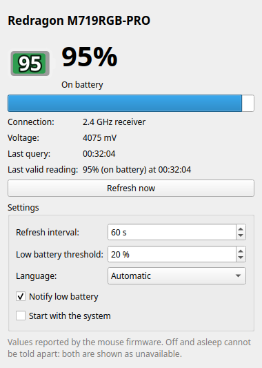

<div align="center">

# Redragon Battery Monitor

**Real battery level of the Redragon M719RGB-PRO mouse on Ubuntu**

[](https://github.com/jean-devbr/redragon-battery-monitor/tree/v0.4.0)


[Português](README.md) · **English**



</div>

---

## Features

- Real percentage reported by the mouse itself
- Top bar icon with charging indicator
- Low battery alert
- Works through the 2.4 GHz receiver and the USB-C cable
- Option to start with the system
- Interface in English and Portuguese
- Terminal command as well

## Requirements

| | |
|---|---|
| **System** | Ubuntu 24.04 (GNOME) |
| **Mouse** | Redragon M719RGB-PRO |
| **Connection** | 2.4 GHz receiver or USB-C cable (Bluetooth is not supported) |

## Installation

Open a terminal and paste:

```bash
curl -fsSL https://raw.githubusercontent.com/jean-devbr/redragon-battery-monitor/main/get.sh | bash
```

> [!NOTE]
> Do not use `sudo` with this command. Your password will be requested during installation.

## Usage

Open **Redragon Battery Monitor** from the applications menu.

- The top bar icon shows the percentage. A yellow border means it is charging.
- Closing the window keeps the program in the top bar. To quit, click the icon and choose **Quit**.
- In the window you can enable **Start with the system**, adjust the low battery alert and choose the **language**.

From the terminal:

```bash
redragon-battery
redragon-battery --lang pt
```

## Language

The program follows the Ubuntu language automatically: Portuguese when the system is in Portuguese and English otherwise. To change it, use the **Language** field in the window or the `--lang pt|en` option in the terminal.

## Updating

Run the installation command again.

## Uninstalling

```bash
redragon-battery-uninstall
```

## Troubleshooting

| Message | Solution |
|---|---|
| Mouse unavailable | Move the mouse and click **Refresh now**. It does not respond while asleep or turned off. |
| No permission to access the device | Unplug and plug the receiver or cable back in. |
| No Redragon M719RGB-PRO found | Check that the receiver or cable is connected. |
| `redragon-battery: command not found` | Log out and log back in. |

## Notes

- The level shown is the one reported by the mouse and may change in 5 % steps.
- When the cable is connected, the level may drop slightly (e.g. 100 % → 95 %). This is how the mouse behaves.

## License

Distributed under the [MIT](LICENSE) license.
