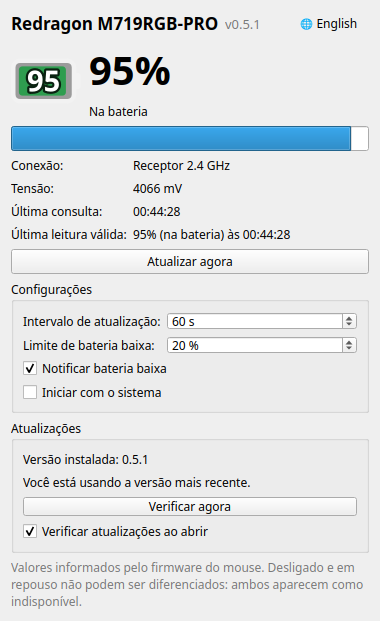

<div align="center">

# Redragon Battery Monitor

**Nível real da bateria do mouse Redragon M719RGB-PRO no Ubuntu**

[](https://github.com/jean-devbr/redragon-battery-monitor/tree/v0.5.1)


**Português** · [English](README.en.md)



</div>

---

## Recursos

- Porcentagem real informada pelo próprio mouse
- Ícone na barra superior, com indicação de carregamento
- Aviso quando a bateria estiver baixa
- Funciona pelo receptor 2.4 GHz e pelo cabo USB-C
- Opção de iniciar junto com o sistema
- Interface em português e inglês
- Aviso de nova versão e atualização pelo próprio programa
- Consulta também pelo terminal

## Requisitos

| | |
|---|---|
| **Sistema** | Ubuntu 24.04 (GNOME) |
| **Mouse** | Redragon M719RGB-PRO |
| **Conexão** | Receptor 2.4 GHz ou cabo USB-C (Bluetooth não é suportado) |

## Instalação

Abra o terminal e cole:

```bash
curl -fsSL https://raw.githubusercontent.com/jean-devbr/redragon-battery-monitor/main/get.sh | bash
```

> [!NOTE]
> Não use `sudo` no comando. A senha será pedida durante a instalação.

## Uso

Abra **Redragon Battery Monitor** no menu de aplicativos.

- O ícone na barra superior mostra a porcentagem. Borda amarela indica que está carregando.
- Fechar a janela mantém o programa na barra. Para encerrar, clique no ícone e escolha **Sair**.
- Na janela é possível ativar **Iniciar com o sistema**, ajustar o aviso de bateria baixa e trocar o **idioma** pelo botão no topo.

Pelo terminal:

```bash
redragon-battery
redragon-battery --lang en
```

## Idioma

O programa usa o idioma do Ubuntu automaticamente: português quando o sistema está em português e inglês nos demais casos. Para trocar, use o botão **🌐 English / 🌐 Português** no topo da janela ou a opção `--lang pt|en` no terminal.

## Atualização

Ao abrir, o programa verifica se existe uma versão nova. Quando houver, clique em **Atualizar** na seção **Atualizações** da janela (ou no item **Atualizar para…** no ícone da barra). A instalação roda em um terminal e o programa é aberto novamente ao final.

Também é possível atualizar rodando de novo o comando de instalação.

## Desinstalação

```bash
redragon-battery-uninstall
```

## Problemas comuns

| Mensagem | Solução |
|---|---|
| Mouse indisponível | Mexa o mouse e clique em **Atualizar agora**. Ele não responde enquanto está em repouso ou desligado. |
| Sem permissão para acessar o dispositivo | Desconecte e conecte novamente o receptor ou o cabo. |
| Nenhum Redragon M719RGB-PRO encontrado | Confira se o receptor ou o cabo está conectado. |
| `redragon-battery: command not found` | Saia da sessão e entre novamente. |

## Observações

- O nível exibido é o informado pelo próprio mouse e pode variar de 5 em 5 %.
- Ao conectar o cabo, o nível pode cair um pouco (ex.: 100 % → 95 %). É o comportamento do mouse.
- A verificação de atualizações consulta o GitHub ao abrir o programa e pode ser desativada em **Atualizações**.

## Autor

Desenvolvido por **Jean Costa**. Acompanhe nas redes:

[](https://www.instagram.com/jeanooficial12/)
[](https://www.linkedin.com/in/jean-costa-0040962b8/)
[](https://www.youtube.com/@aprendendoComJean)

## Licença

Distribuído sob a licença [MIT](LICENSE).
